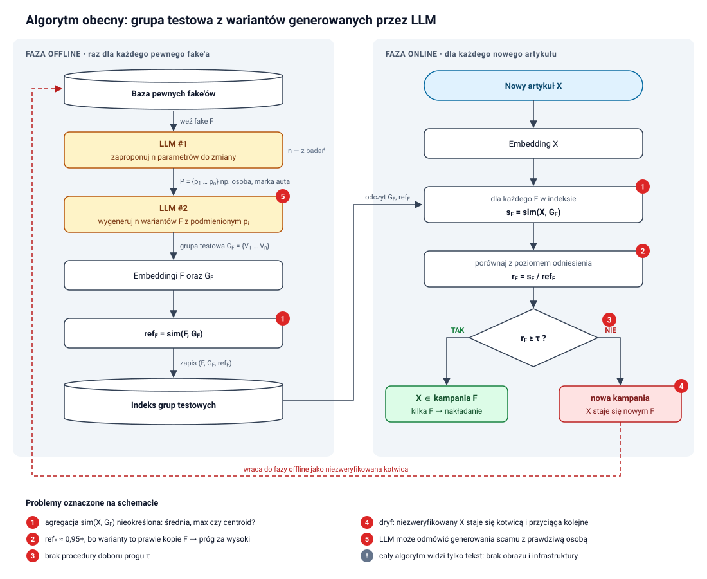
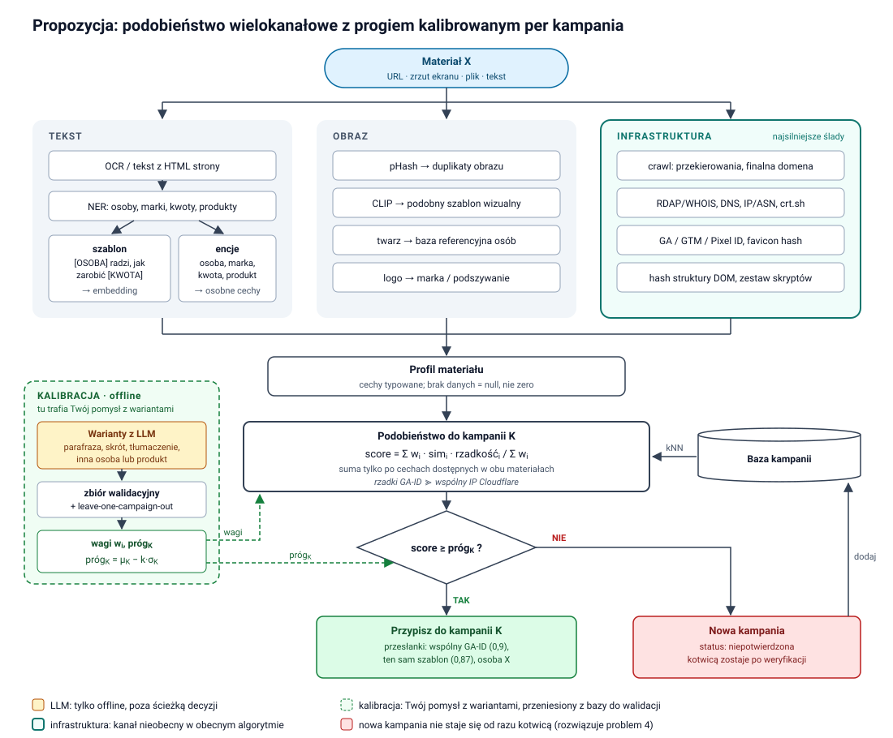

# Analiza algorytmu grupowania reklam: problemy i propozycje

Dotyczy wyzwania HackNation „Kolekcjoner fejków / Follow the Fake” (NASK PIB).
Schematy: [`diagram_obecny.svg`](diagram_obecny.svg) i [`diagram_proponowany.svg`](diagram_proponowany.svg).

**Wniosek w skrócie.** Pętla „porównaj nowy materiał z bazą, przypisz albo utwórz nową kampanię” jest zgodna z zadaniem, a pomysł na osobny poziom odniesienia dla każdej kampanii jest dobry. Słabym punktem jest generowanie grupy testowej przez LLM: kosztuje dużo, niewiele dodaje do podobieństwa i zawyża próg. Największa luka to brak cech infrastruktury (domeny, przekierowania, identyfikatory śledzące), czyli śladów, które w tym zadaniu najmocniej łączą reklamy w kampanie.

---

## 1. Algorytm obecny



**Faza offline** (raz dla każdego pewnego fake'a F):

1. LLM #1 proponuje n parametrów do zmiany, np. osobę albo markę samochodu. Wartość n ma wyjść z badań.
2. LLM #2 generuje n wariantów F z podmienionymi parametrami. Powstaje grupa testowa G_F.
3. Liczone są embeddingi oraz poziom odniesienia `ref_F = sim(F, G_F)`.
4. Trójka (F, G_F, ref_F) trafia do indeksu.

**Faza online** (dla każdego nowego artykułu X):

1. Liczony jest embedding X.
2. Dla każdego F w indeksie: `s_F = sim(X, G_F)`.
3. Porównanie z poziomem odniesienia: `r_F = s_F / ref_F`.
4. Jeśli `r_F ≥ τ`, X należy do kampanii F. Może pasować do kilku kampanii naraz.
5. Jeśli żadne F nie przekracza progu, X zakłada nową kampanię i wraca do fazy offline jako nowa kotwica.

---

## 2. Co warto zachować

| Element | Dlaczego jest dobry | Gdzie trafia w propozycji |
|---|---|---|
| Porównanie `s_F` z `ref_F` | To próg kalibrowany osobno dla każdej kampanii. Jeden globalny próg zwykle się nie sprawdza, bo kampanie różnią się jednorodnością. | `próg_K = μ_K − k·σ_K` |
| Generowanie wariantów przez LLM | Pozwala sprawdzić, czy system rozpoznaje warianty znanych kampanii. To dokładnie ten scenariusz, na którym organizator testuje rozwiązania. | Zbiór walidacyjny, nie baza |
| Nowa kampania przy braku dopasowania | Zgodne z wymaganiem „określ, czy materiał reprezentuje nowy wzorzec działania”. | Bez zmian, plus status „niepotwierdzona” |
| Dostrajanie parametrów w trakcie testów | Trafna intuicja, tylko dostrajać trzeba co innego. | Dostrajane są wagi cech i progi, nie liczba wariantów |

---

## 3. Problemy

| # | Problem | Waga | Na schemacie |
|---|---|---|---|
| P1 | Brak kanału infrastruktury | krytyczny | ! |
| P2 | Grupa testowa niewiele wnosi, a `ref_F` jest zawyżone | krytyczny | ② |
| P3 | Brak wyjaśnienia, dlaczego materiały zostały połączone | krytyczny | – |
| P4 | Cel ustawiony na klasyfikację fake newsów | istotny | – |
| P5 | Cechy nieistotne zdefiniowane w niewłaściwy sposób | istotny | – |
| P6 | Nieokreślona agregacja podobieństwa do grupy | istotny | ① |
| P7 | Brak procedury doboru progu τ | istotny | ③ |
| P8 | Dryf: niezweryfikowany materiał staje się kotwicą | istotny | ④ |
| P9 | LLM może odmówić generowania treści | istotny | ⑤ |
| P10 | Niekompletne dane i cloaking stron | istotny | – |
| P11 | Brak osobnego kroku deduplikacji | istotny | – |
| P12 | Nakładające się grupy utrudniają ocenę | drobny | – |
| P13 | Koszt i skalowanie | drobny | – |
| P14 | Zasady użycia danych organizatora | formalny | – |

### P1. Brak kanału infrastruktury (krytyczny)

**Dlaczego to problem.** Opis wyzwania kilka razy wymienia domeny, przekierowania, linki, strukturę stron i metadane domen. To najsilniejsze ślady wspólnego źródła. Dwie reklamy z różnymi celebrytami i innym tekstem, ale z tym samym identyfikatorem Google Analytics albo pikselem Meta, to niemal na pewno jedna kampania. Kryterium „użyteczność i trafność cech oraz źródeł danych” to 30% oceny.

**Propozycja.** Dodać kanał infrastruktury (szczegóły w sekcji 4.1). Większość tych cech pobiera się prostymi zapytaniami i porównuje dokładnym dopasowaniem, więc daje dużo przy małym nakładzie.

### P2. Grupa testowa niewiele wnosi, a `ref_F` jest zawyżone (krytyczny)

**Dlaczego to problem.**
- Embeddingi tekstu (e5, sentence-transformers) prawie nie reagują na podmianę jednej nazwy w dłuższym tekście. Warianty V_i są więc praktycznie kopiami F, a `ref_F` wychodzi około 0,95 lub wyżej.
- Nowy materiał, który różni się od F tylko osobą, i tak dostałby wysokie zwykłe `sim(X, F)`. Grupa niczego tu nie dodaje.
- Prawdziwe warianty kampanii różnią się bardziej: parafrazą, skróceniem, innym produktem, tłumaczeniem, innym układem strony. Ich podobieństwo wypada wyraźnie poniżej `ref_F`. Skutek to fałszywe negatywy, i to właśnie w scenariuszu, który organizator będzie testował, czyli „nowe warianty znanych kampanii”.
- Syntetyczne rekordy mają styl LLM, a nie styl oszustów. Podobieństwo mierzy więc częściowo „czy to brzmi jak LLM”.

**Propozycja.** Niewrażliwość na podmianę osoby czy marki uzyskać wprost, przez maskowanie encji (sekcja 4.2). Generowanie z LLM przenieść do kalibracji i walidacji, i generować tam realistyczne typy zmian, a nie tylko podmianę jednej nazwy.

### P3. Brak wyjaśnienia, dlaczego materiały zostały połączone (krytyczny)

**Dlaczego to problem.** Interpretowalność to 15% oceny i osobny punkt walidacji: organizator chce, żeby rozwiązanie wskazywało przesłanki powiązania. Iloraz `r_F` mówi tylko „podobne w 0,97”, a nie dlaczego.

**Propozycja.** Wynik liczyć jako sumę wkładów poszczególnych cech (sekcja 4.3). Wtedy wyjaśnienie powstaje automatycznie, bo wystarczy pokazać cechy z największym wkładem, np. „wspólny GA-ID (0,9), ten sam szablon (0,87), ta sama osoba”.

### P4. Cel ustawiony na klasyfikację fake newsów (istotny)

**Dlaczego to problem.** Organizator pisze wprost: „Nie oczekujemy stworzenia idealnego detektora pojedynczej fałszywej reklamy”. Zadanie dotyczy też reklam scamowych (fałszywe inwestycje, „cudowne” leki), a nie fake newsów w sensie dezinformacji.

**Propozycja.** Nie budować klasyfikatora „fake / nie fake”. Każdy materiał na wejściu traktować jako podejrzany i skupić się na łączeniu materiałów w kampanie.

### P5. Cechy nieistotne zdefiniowane w niewłaściwy sposób (istotny)

**Dlaczego to problem.**
- Osoba w reklamie jest w tej domenie cechą istotną. Organizator sugeruje nawet zbudowanie bazy referencyjnej celebrytów.
- Kolor skóry nie jest realnym źródłem błędów grupowania. Źródłem fałszywych połączeń są cechy pospolite: IP Cloudflare współdzielone przez miliony stron, certyfikaty Let's Encrypt, popularni rejestratorzy, ramka interfejsu Facebooka na zrzucie ekranu, typowe słowa w rodzaju „inwestycja” czy „zarabiaj”.

**Propozycja.** Ważyć cechy rzadkością, podobnie jak IDF w wyszukiwaniu tekstu: `rzadkość = log(N / df)`, gdzie df to liczba materiałów z daną wartością cechy. Wspólny rzadki identyfikator to mocny dowód, wspólny popularny hosting niemal żaden. Dodatkowo prowadzić ręczną listę wartości ignorowanych (CDN, popularne hostingi, szablon interfejsu platformy).

### P6. Nieokreślona agregacja podobieństwa do grupy, ① (istotny)

**Dlaczego to problem.** `sim(X, G_F)` może oznaczać średnią, maksimum albo podobieństwo do centroidu, a każda z tych opcji zachowuje się inaczej. Średnia premiuje materiały „pośrodku” grupy. Maksimum jest podatne na jeden przypadkowo podobny wariant. Centroid zaciera różnorodność grupy.

**Propozycja.** Liczyć podobieństwo do kampanii jako średnią z k najbardziej podobnych członków (top-k, np. k = 3). Tę wartość zestawiać z rozkładem podobieństw wewnątrz kampanii.

### P7. Brak procedury doboru progu τ, ③ (istotny)

**Dlaczego to problem.** Bez procedury τ zostaje dobrane „na oko”. Iloraz `s_F / ref_F` nie uwzględnia też rozrzutu: dla zwartej kampanii 0,9 to dużo, dla luźnej mało.

**Propozycja.** `próg_K = μ_K − k·σ_K`, gdzie μ_K i σ_K to średnia i odchylenie standardowe podobieństw wariantów walidacyjnych do kampanii K. Parametr k stroić na zbiorze walidacyjnym. Kampanie z małą liczbą członków (np. poniżej 3) dostają próg globalny.

### P8. Dryf: niezweryfikowany materiał staje się kotwicą, ④ (istotny)

**Dlaczego to problem.** Jeśli każdy nowy X automatycznie zostaje pewnym fake'iem, jeden błędnie przypisany lub nietypowy materiał zaczyna przyciągać kolejne, a kampanie się zlewają.

**Propozycja.** Nowa kampania dostaje status „niepotwierdzona”. Przy dopasowaniach ma mniejszą wagę, a kotwicą staje się dopiero po zatwierdzeniu przez analityka w GUI albo po dołączeniu kilku materiałów z mocnym powiązaniem.

### P9. LLM może odmówić generowania treści, ⑤ (istotny)

**Dlaczego to problem.** Prośba „napisz artykuł, w którym [znana osoba] poleca inwestycję” to scenariusz, który komercyjne modele często blokują. Jeśli wyjdzie to w połowie hackathonu, rdzeń algorytmu przestaje działać.

**Propozycja.** Sprawdzić to w pierwszej godzinie. W wersji z maskowaniem encji LLM nie jest potrzebny w ścieżce decyzji, tylko do walidacji. Tam można generować warianty szablonów z placeholderami zamiast prawdziwych nazwisk.

### P10. Niekompletne dane i cloaking stron (istotny)

**Dlaczego to problem.** Strony docelowe żyją krótko, a często pokazują botom neutralną treść zamiast właściwej (cloaking). Organizator wprost wymaga odporności na brakujące dane. Liczenie brakującej cechy jako 0 zaniża podobieństwo.

**Propozycja.**
- Brak danych zapisywać jako `null` i liczyć wynik tylko po cechach dostępnych w obu materiałach, z normalizacją sumą wag dostępnych cech.
- Przy pobieraniu stron używać mobilnego user-agenta, polskiego locale i referera z platformy społecznościowej.
- Zapisywać zrzut i HTML przy pierwszym kontakcie, bo za tydzień domeny może już nie być.
- Pokazywać w GUI, których kanałów zabrakło.

### P11. Brak osobnego kroku deduplikacji (istotny)

**Dlaczego to problem.** Duplikaty sztucznie zawyżają liczebność kampanii i zniekształcają statystyki progu. Odporność na duplikaty jest osobnym punktem walidacji.

**Propozycja.** Deduplikacja jako pierwszy krok: pHash obrazu, hash znormalizowanego tekstu i finalny URL. Duplikat zostaje podpięty pod istniejący rekord, a nie trafia do bazy jako nowy materiał.

### P12. Nakładające się grupy utrudniają ocenę (drobny)

**Dlaczego to problem.** Organizator ocenia poprawność przypisania do istniejących grup. Jeśli materiał należy jednocześnie do trzech grup, trudno to zmierzyć i trudno pokazać.

**Propozycja.** Hierarchia zamiast nakładania: duplikat → wariant → kampania → rodzina kampanii. Każdy materiał ma jedną kampanię, a powiązania między kampaniami są osobnymi krawędziami „podobna do”. Zachowuje to intencję nakładania, a jest jednoznaczne w ocenie.

### P13. Koszt i skalowanie (drobny)

**Dlaczego to problem.** Liczba wywołań LLM to (liczba fake'ów) × (n + 1), a baza rośnie n-krotnie. Porównanie z każdą grupą to O(|baza| × n) na każde zapytanie.

**Propozycja.** Bez LLM w ścieżce decyzji ten koszt znika. Do wyszukiwania kandydatów użyć indeksu ANN (FAISS) po embeddingach, a dokładne dopasowania infrastruktury realizować przez indeks odwrócony (wartość cechy → lista materiałów).

### P14. Zasady użycia danych organizatora (formalny)

Materiałów od organizatora nie wolno rozpowszechniać publicznie. Dane nie mogą trafić do publicznego repozytorium, więc trzeba je dodać do `.gitignore` i opisać w README, gdzie je umieścić. Wymagany jest też wykaz użytych bibliotek, modeli i usług wraz z licencjami.

---

## 4. Algorytm proponowany



### 4.1. Kanały i cechy

| Kanał | Cecha | Narzędzie (przykład) | Sposób porównania | Siła sygnału |
|---|---|---|---|---|
| Infrastruktura | identyfikatory GA / GTM / Meta Pixel / TikTok Pixel | regex na HTML | dokładne dopasowanie | bardzo wysoka |
| Infrastruktura | favicon hash | `mmh3` | dokładne dopasowanie | wysoka |
| Infrastruktura | łańcuch przekierowań, finalna domena | Playwright | dopasowanie domen i ścieżek | wysoka |
| Infrastruktura | hash struktury DOM, zestaw skryptów | własny (tagi + klasy) | Jaccard / SimHash | wysoka |
| Infrastruktura | rejestrator, data rejestracji, NS | RDAP / WHOIS | dopasowanie + bliskość dat | średnia |
| Infrastruktura | IP, ASN, certyfikaty | dnspython, ipwhois, crt.sh | dopasowanie, ważone rzadkością | średnia lub niska (CDN) |
| Tekst | szablon po zamaskowaniu encji | spaCy (NER PL) + multilingual-e5 | cosinus | wysoka |
| Tekst | encje: osoba, marka, produkt, kwota | spaCy NER | Jaccard | średnia |
| Tekst | słowa kluczowe, tematyka | KeyBERT / TF-IDF | cosinus | niska lub średnia |
| Obraz | duplikat obrazu | `imagehash` (pHash) | odległość Hamminga | wysoka (duplikaty) |
| Obraz | szablon wizualny | open_clip | cosinus | średnia |
| Obraz | osoba | insightface / face_recognition + baza referencyjna | identyfikator osoby | średnia |
| Obraz | logo / marka | CLIP zero-shot albo dopasowanie wzorców | dopasowanie | średnia |

### 4.2. Maskowanie encji zamiast generowania wariantów

```
oryginał:  „Jan Kowalski ujawnia, jak zarobić 15 000 zł miesięcznie na platformie QuantumAI”
szablon:   „[OSOBA] ujawnia, jak zarobić [KWOTA] miesięcznie na platformie [PRODUKT]”
encje:     {osoba: Jan Kowalski, kwota: 15 000 zł, produkt: QuantumAI}
```

- Podobieństwo szablonów wychwytuje warianty z podmienioną osobą lub produktem, czyli to, co miała dawać grupa testowa, ale deterministycznie i bez kosztu.
- Encje nie przepadają, tylko stają się osobnymi cechami. Ta sama osoba w dwóch materiałach to dodatkowy dowód.
- Wyjaśnienie jest czytelne: „ten sam szablon po zamaskowaniu osoby i produktu”.

### 4.3. Podobieństwo

```
score(X, Y) = Σ_i w_i · sim_i(X, Y) · rzadkość_i  /  Σ_i w_i
              (sumy tylko po cechach i dostępnych zarówno w X, jak i w Y)

rzadkość_i = log(N / df_i) / log(N)      (znormalizowane do [0, 1])
```

- **Mocne powiązania.** Wspólna rzadka wartość identyfikatora (GA-ID, Pixel ID, favicon hash spoza listy popularnych) łączy materiały regułą, niezależnie od reszty wyniku. Takie powiązanie jest pokazywane jako osobny typ krawędzi.
- **Słabe powiązania.** Podobieństwa embeddingów i zbiorów encji łączone ważoną sumą.
- **Podobieństwo do kampanii K** to średnia ze `score` do k najbardziej podobnych członków K.
- **Kandydaci** pochodzą z ANN (FAISS) po embeddingach oraz z indeksu odwróconego po wartościach cech infrastruktury.

### 4.4. Decyzja i kalibracja

1. Dla każdej kampanii K: `próg_K = μ_K − k·σ_K`, gdzie μ_K i σ_K pochodzą z podobieństw wariantów walidacyjnych do K.
2. Kampanie z małą liczbą członków dostają próg globalny τ.
3. Jeśli `score ≥ próg_K`, materiał zostaje przypisany do kampanii z najwyższym wynikiem. Pozostałe kampanie powyżej progu zapisuje się jako „podobne”.
4. Jeśli żadna kampania nie przekracza progu, powstaje nowa kampania ze statusem „niepotwierdzona”.
5. Wagi w_i stroić na zbiorze walidacyjnym, np. przeszukiwaniem siatki albo regresją logistyczną na parach „ta sama kampania / inna kampania”. Współczynniki regresji też są interpretowalne.

### 4.5. Hierarchia grup

| Poziom | Kryterium (przykład) |
|---|---|
| Duplikat | pHash ≤ 6 albo identyczny hash znormalizowanego tekstu |
| Wariant | podobieństwo szablonu ≥ 0,9 albo wspólny rzadki identyfikator |
| Kampania | `score ≥ próg_K` |
| Rodzina kampanii | wspólna infrastruktura lub szablon między kampaniami, np. wykrywanie społeczności algorytmem Leiden na grafie kampanii |

### 4.6. Reprezentacja i prezentacja

- **Graf.** Węzły to materiały, domeny, IP, identyfikatory śledzące, osoby i szablony. Krawędzie przechowują przesłanki i wagi. Do demonstracji wystarczy NetworkX z wizualizacją pyvis; Neo4j to opcja, jeśli zostanie czas.
- **GUI (Streamlit).** Wejście: URL, zrzut ekranu albo plik. Wyjście: wyodrębnione cechy, lista podobnych materiałów z przesłankami, przypisana kampania i graf jej otoczenia.

---

## 5. Ewaluacja

- **Metryki grupowania:** pairwise precision / recall / F1, B-cubed F1, ARI.
- **Przypisanie nowych materiałów (leave-one-out):** usunąć materiał ze zbioru i sprawdzić, czy wraca do swojej kampanii.
- **Wykrywanie nowej kampanii (leave-one-campaign-out):** usunąć całą kampanię i sprawdzić, czy jej materiały tworzą nową grupę, zamiast dołączać do innych. Ten scenariusz odpowiada wymaganiu, by wskazywać materiały, których nie należy łączyć z istniejącymi kampaniami.
- **Odporność:** warianty z LLM (parafraza, skrót, tłumaczenie, podmiana osoby lub produktu) oraz materiały celowo zubożone (bez strony, bez zrzutu ekranu, bez metadanych).
- **Ablacja kanałów:** wynik po wyłączeniu każdego kanału osobno. Pokazuje przydatność i różnorodność cech, czyli wprost jeden z punktów walidacji.

---

## 6. Mapowanie na kryteria oceny

| Kryterium | Waga | Co je pokrywa |
|---|---|---|
| Jakość korelacji i grupowania | 30% | score z wagą rzadkości, kalibracja per kampania, hierarchia, ewaluacja |
| Użyteczność cech i źródeł danych | 30% | trzy kanały, zwłaszcza infrastruktura; ablacja jako dowód |
| Kompletność demonstratora end-to-end | 15% | Streamlit: wejście → cechy → porównanie → grupa → graf |
| Czytelność i interpretowalność | 15% | przesłanki z wkładów cech, typy krawędzi w grafie |
| Potencjał wdrożeniowy i przenośność | 10% | Docker, FAISS i indeks odwrócony, scheduler jako bonus |

---

## 7. Kolejność prac

1. Wczytanie przykładowego zbioru, deduplikacja i ekstrakcja tekstu oraz infrastruktury: najtańsze i najsilniejsze cechy.
2. Score z wagą rzadkości, przesłanki i pierwsze grupowanie. Od razu mierzyć wyniki na udostępnionym zbiorze.
3. Minimalne GUI w Streamlit z całym procesem end-to-end.
4. Kanał obrazu: pHash, CLIP, twarze z małą bazą referencyjną.
5. Kalibracja progów i wag, zbiór walidacyjny z LLM, ablacja.
6. Docker, README, opis metodyki, wykaz licencji.
7. Bonus: scheduler przeszukujący biblioteki reklam (np. Meta Ad Library) po słowach kluczowych.

**Licencje do sprawdzenia przed użyciem:** każdy model i biblioteka. Przykładowo udostępniane wstępnie wytrenowane modele insightface są przeznaczone tylko do użytku niekomercyjnego, co trzeba odnotować w dokumentacji.
